# Bài 6. Lập trình ASM cơ bản
## Lý thuyết
#### 1. Các thanh ghi trong x86
*Nguồn tham khảo: [Intel® 64 and IA-32 Architectures](https://cdrdv2.intel.com/v1/dl/getContent/671436)*.
Gồm 16 thanh ghi cơ bản, chia làm 4 nhóm: General-purpose registers, Segment registers, EFLAGS (program status and control) register, EIP (instruction pointer) register.
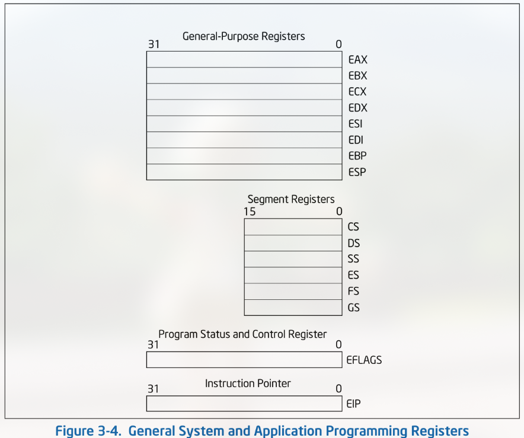

**Thanh ghi mục đích chung (General-purpose register)**
Các thanh ghi 32-bit EAX, EBX, ECX, EDX, ESI, EDI, EBP, ESP có các chức năng:
* Lưu trữ toán hạng cho phép toán số học/logic.
* Lưu trữ toán hạng cho phép toán địa chỉ.
* Lưu trữ địa chỉ.

Tuy nhiên, ESP theo quy ước chỉ dùng để lưu trữ con trỏ đến đỉnh stack.
Một số chức năng đặc biệt thường thấy ở các thanh ghi trên:
* EAX: lưu trữ toán hạng và kết quả phép toán.
* EBX: con trỏ đến dữ liệu trong phân đoạn của thanh ghi DS.
* ECX: bộ đếm cho phép toán xâu và vòng lặp.
* EDX: con trỏ I/O.
* ESI: con trỏ đến dữ liệu trong phân đoạn của DS, là con trỏ nguồn cho các phép xâu.
* EDI: con trỏ đến dữ liệu (hoặc đích đến) trong phân đoạn của ES, là con trỏ đích cho các phép toán xâu.
* ESP: Stack pointer.
* EBP: con trỏ đến dữ liệu trong stack.

**Thanh ghi phân đoạn (Segment register)**
Các thanh ghi CS, DS, SS, ES, FS, GS lưu trữ các bộ chọn đoạn 16-bit (segment selector). 1 bộ chọn đoạn là 1 con trỏ đặc biệt, có chức năng xác định 1 phân vùng trong bộ nhớ, được trỏ đến bởi thanh ghi phân đoạn.
* CS: lưu trữ bộ chọn đoạn cho phân đoạn mã (code segment) - nơi lưu trữ các lệnh đang thực thi. CS không thể được nạp tường minh bởi chương trình, mà được nạp ẩn bởi các lệnh/phép toán nội bộ của CPU. 
* SS: lưu trữ bộ chọn đoạn cho phân đoạn stack (stack segment). Mọi phép toán trên stack đều dùng SS để tìm phân đoạn stack. SS có thể được nạp tường minh, cho phép chương trình thiết lập nhiều stack để sử dụng.
* DS, ES, FS, GS: trỏ đến 4 phân vùng dữ liệu (data segment) cho các kiểu cấu trúc dữ liệu khác nhau như: 
  * CTDL của module hiện tại.
  * Dữ liệu xuất bởi module cấp cao hơn. 
  * CTDL được khởi tạo động.
  * Dữ liệu chia sẻ với chương trình khác.

**Thanh ghi EFLAGS**
Là 1 thanh ghi 32-bit lưu trữ 1 nhóm bao gồm các cờ trạng thái, 1 cờ điều khiển, và 1 nhóm các cờ hệ thống.
Từ khởi tạo mặc định của CPU, trạng thái của của thanh ghi này là 0x00000002. Các bit 1, 3, 5, 15, và từ 22 đến 31 theo quy ước là các bit bảo tồn.
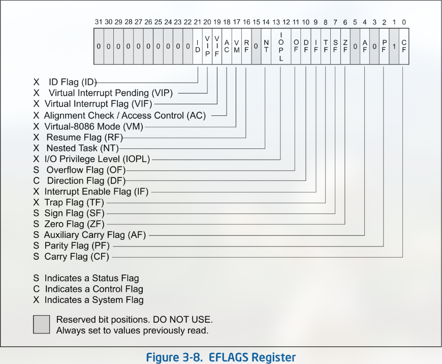

* Các cờ trạng thái: cho biết kết quả của phép toán số học.
  * CF (bit 0) - Carry flag: thiết lập nếu phép toán có nhớ trên most-significant bit của kết quả. 
  * PF (bit 2) - Parity flag: thiết lập nếu LSB của kết quả chứa số lượng chẵn bit 1.
  * AF (bit 4) - Auxiliary Carry flag: thiết lập nếu phép toán có nhớ trên bit 3 của kết quả.
  * ZF (bit 6) - Zero flag: thiết lập nếu kết quả = 0.
  * SF (bit 7) - Sign flag: thiết lập bằng bit most-significant của kết quả.
  * OF (bit 11) - Overflow flag: thiết lập nếu tràn số.

* Cờ DF (direction flag, bit 10): điều khiển các lệnh trên xâu. Thiết lập cờ này khiến lệnh tự động giảm - xử lý xâu từ địa chỉ cao xuống thấp, và ngược lại.

* Các cờ hệ thống và trường IOPL: điều khiển hệ điều hành. Các cờ này không nên được tùy chỉnh bởi chương trình.
  * TF (bit 8) - Trap flag: thiết lập debug chế độ từng bước.
  * IF (bit 9) - Interrupt enable flag: thiết lập phản hồi lại các yêu cầu ngắt từ phần cứng.
  * IOPL (bits 12, 13) - I/O privilege level field: cho biết mức ưu tiên truy cập I/O của chương trình hiện tại.
  * NT (bit 14) - Nested task flag: điều khiển chuỗi các tác vụ được gọi/ngắt. Thiết lập khi tác vụ hiện tại có liên kết tới tác vụ được thực thi trước đó.
  * RF (bit 16) - Resume flag: điều khiển phản hồi của CPU với các ngoại lệ debug.
  * VM (bit 17) - Virtual-8086 mode flag.
  * AC (bit 18) - Alignment check (or access control) flag.
  * VIF (bit 19) - Virtual interrupt flag.
  * VIP (bit 20) - Virtual interrupt pending flag.
  * ID (bit 21) - Identification flag.

**Thanh ghi EIP - con trỏ lệnh**
Lưu trữ offset trong code segment hiện tại của lệnh tiếp theo cần thực thi.
EIP không thể được truy cập trực tiếp bởi phần mềm, mà được điều khiển ngầm bởi các lệnh chuyển đổi điều khiển (JMP, Jcc, CALL...), ngắt, và ngoại lệ.

Cách duy nhất để đọc thanh ghi EIP là thực thi lệnh CALL rồi đọc giá trị của con trỏ lệnh trả về trên đỉnh stack. Ví dụ:
```nasm
get_eip:
    call next_instr     ; push địa chỉ của `next_ins` vào stack, nhảy vào hàm.
next_ins:
    pop eax             ; pop dữ liệu trong stack vào EAX 
                        ;-> lúc này eax lưu địa chỉ của `next_ins`, 
                        ; = địa chỉ hiện tại của EIP.
```

EIP có thể được nạp gián tiếp thông qua chỉnh sửa giá trị của con trỏ lệnh trả về trên đỉnh stack và thực thi lệnh trả về (RET/IRET). Ví dụ:
```nasm
function_a:
    push    ebp              ; 2 lệnh bảo lưu frame pointer cũ.
    mov     ebp, esp

    mov     eax, <target>    ; địa chỉ muốn nhảy vào
    mov     [ebp+4], eax     ; ghi đè địa chỉ trả về đã lưu trên stack

    pop     ebp
    ret                      ; pop giá trị mới vào EIP -> nhảy đến target.
```

#### 2. Calling convention - stack và cách lưu trữ tham số vào thanh ghi
*Nguồn tham khảo: [Agner Fog](https://www.agner.org/optimize/calling_conventions.pdf)*.
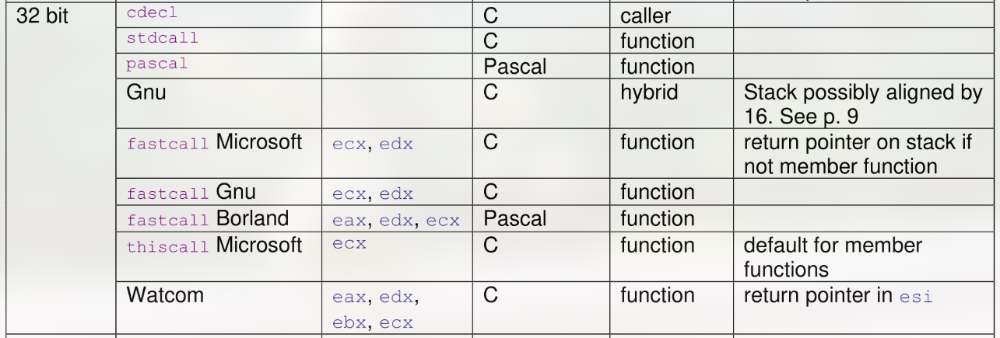

**Lưu trữ tham số:**
Nếu 1 calling convention không sử dụng thanh ghi dể lưu tham số, toàn bộ tham số được lưu vào stack. Nếu có sử dụng thanh ghi nhưng số lượng thanh ghi lưu tham số bị thiếu, những tham số còn lại lưu vào stack. Trình tự lưu tham số vào stack:
- Theo ngôn ngữ C: đẩy tham số vào stack theo thứ tự từ phải sang trái. Tham số đầu tiên sẽ được đẩy vào cuối cùng, ở địa chỉ stack thấp hơn.
- Theo ngôn ngữ Pascal: theo thứ tự từ trái sang phải. Tham số đầu tiên được đẩy vào đầu tiên, ở địa chỉ stack cao hơn.

| Calling convention | Lưu trữ tham số trong thanh ghi | Lưu trữ tham số trên stack |
| :--- | :--- | :--- |
| cdecl | Không | C |
| stdcall | Không | C |
| pascal | Không | Pascal |
| Gnu | Không | C |
| fastcall (Microsoft) | Tham số thứ nhất lưu vào ecx, tham số thứ hai lưu vào edx | C |
| fastcall (Gnu) | Tham số 1->ecx, tham số 2->edx | C |
| fastcall (Borland) | Tham số 1->eax, tham số 2->edx, tham số 3->ecx| Pascal |
| thiscall Microsoft | Tham số 1->ecx | C |
| Watcom | Tham số 1->eax, tham số 2->edx, tham số 3->ebx, tham số 4->ecx | C |

## Thực hành
> Viết 1 chương trình asm x86, gọi WinAPI, đọc vào filepath, và 1 ký tự được nhập vào thông qua input console. Mở file, đọc file và đếm số lần xuất hiện của ký tự đó trong file, hiển thị ra output console.

Sử dụng MASM.

Khai báo case-sensitive để gọi WinAPI, và các thư viện cần thiết
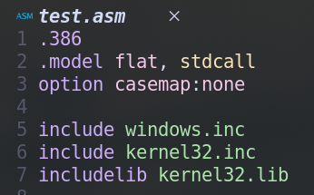

Khai báo các hằng và biến cần thiết
* 3 hằng số: độ dài tối đa cho file path, kích thước file, kích thước kết quả in ra console.
* handle cho stdin/out, file đọc vào.
* Các buffer cần thiết cho các hàm đọc dữ liệu.
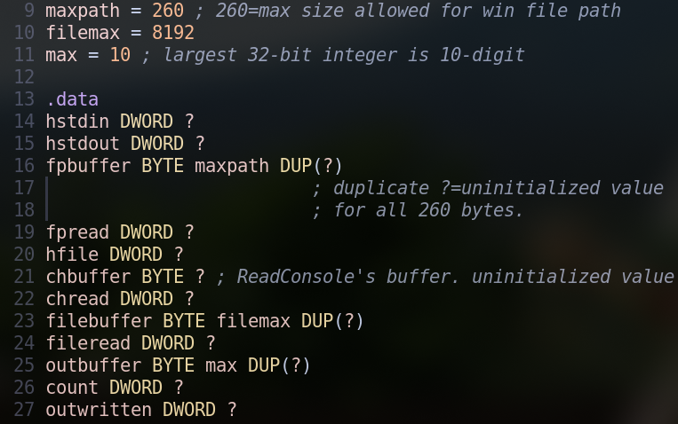

Mặc định các handle trả về register EAX theo quy ước.
Gọi WinAPI truy cập stdin console và gọi ReadConsole để đọc file path và ký tự nhập vào.
Sau khi đọc, tiến hành xử lý null-terminate file path để loại bỏ \r\n.
Tiếp theo, gọi đến CreateFileA để mở file, và ReadFile để đọc nội dung file.
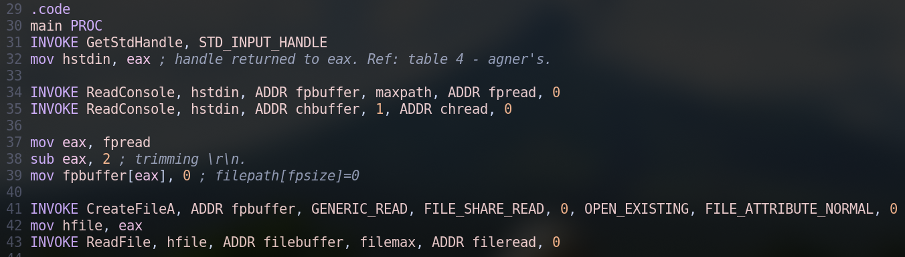

Chương trình sử dụng 3 vòng lặp.

Vòng lặp 1: so sánh từng ký tự trong nội dung file đọc với ký tự nhập vào. Sử dụng lệnh lặp `loop` (mặc định bộ đếm là ECX theo quy ước)
* ESI làm con trỏ iterator duyệt qua từng byte trong file.
* EDX là bộ đếm số lần xuất hiện ký tự.
* Lưu trữ giá trị của byte mà ESI đang trỏ đến trong AL.
* So sánh AL (lệnh `cmp`) với ký tự đọc vào.
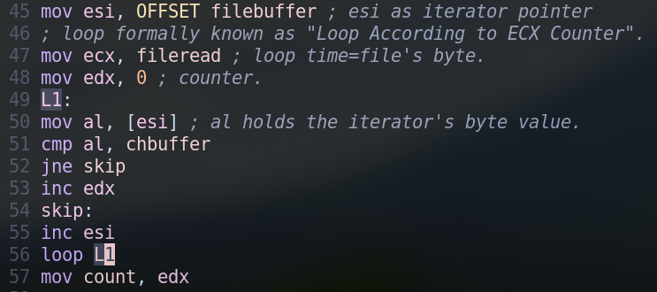

Vòng lặp 2: chuyển từng digit của kết quả đếm số lần xuất hiện sang ký tự ASCII để in ra console.
Sử dụng lệnh div (quy ước dùng eax làm số bị chia và edx làm số dư).
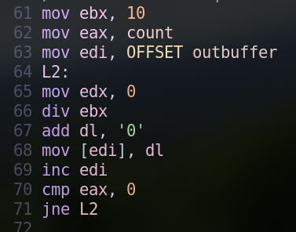

Vòng lặp 3: vì kết quả phần dư của phép chia luôn có thứ tự ngược lại so với số bị chia, nên cần in ra theo thứ tự ngược lại. 
Đặt ESI ở đầu buffer lưu kết quả phần dư, EDI lúc này đang trỏ đến cuối buffer đó. Duyệt lùi EDI và in ra console cho đến khi EDI=ESI.
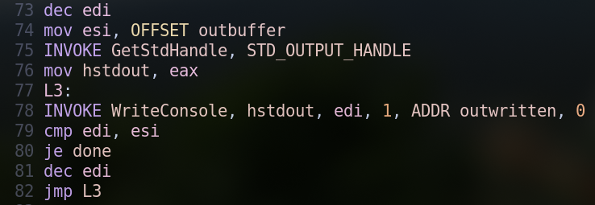

Kết thúc chương trình: đóng handle đã tạo, thoát chương trình.
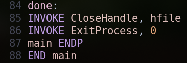

Biên dịch và liên kết:
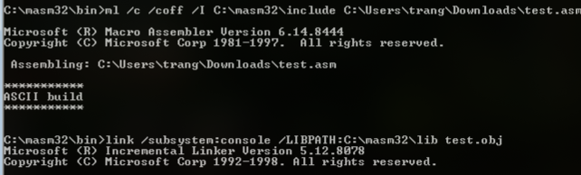
Kết quả chạy: thành công
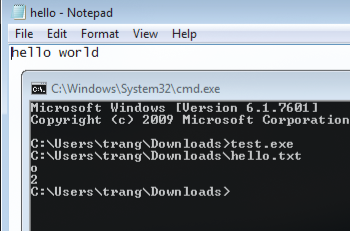